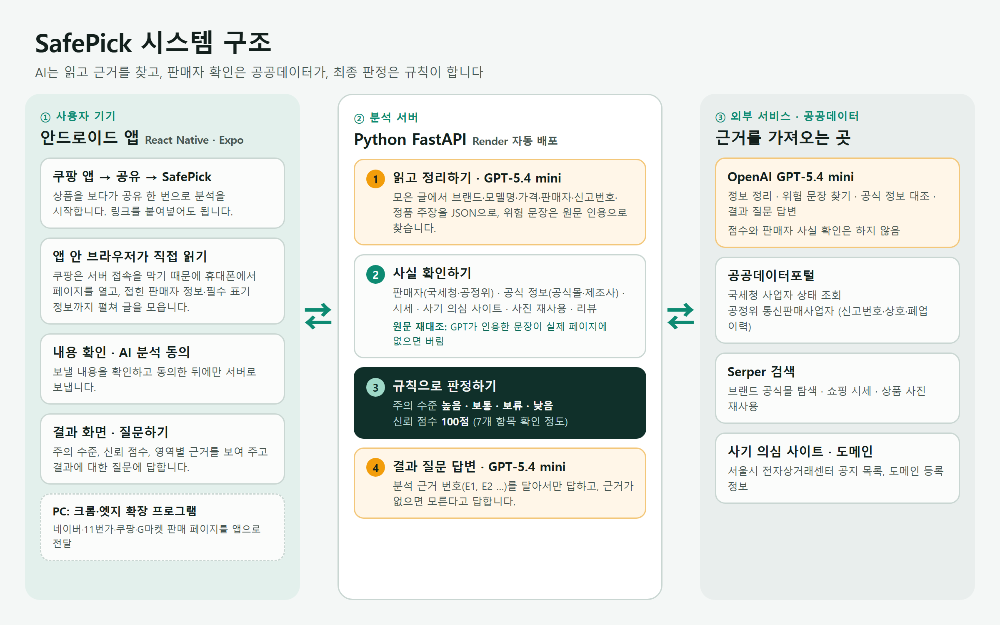
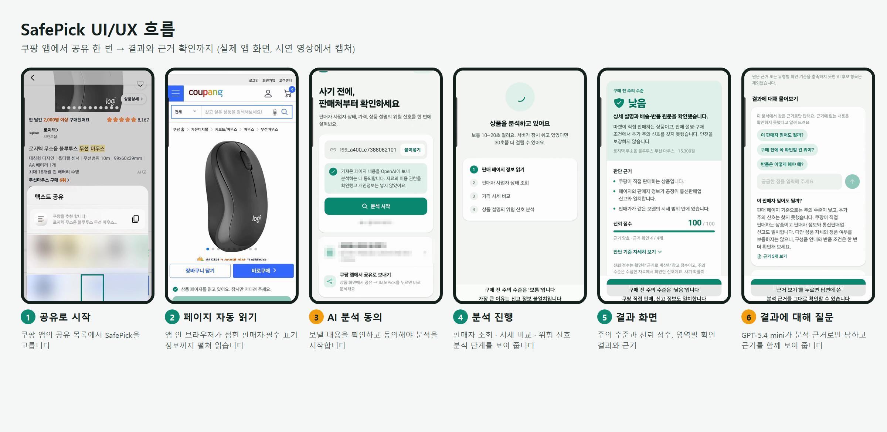

# SafePick

**SafePick(세이프픽)** — 생성형 AI 기반 오픈마켓 판매처 확인 앱

쿠팡 판매 페이지를 공유하면 판매자·가격·설명·리뷰를 근거로 구매 전 **주의 수준**과 **신뢰 점수**를 알려 주는 안드로이드 앱입니다. 상품을 사기·가품으로 단정하지 않고, 사용자가 직접 확인할 수 있는 근거를 주는 **구매 전 판단 보조 서비스**를 목표로 합니다. 최종 구매 결정은 사용자가 내립니다.

- GitHub: <https://github.com/lyh030526/SafePick>
- 프로젝트 문서(Notion): <https://app.notion.com/p/1-3ea33f97d4d58114b633c3e23b8ef0cc>
- 사용한 생성형 LLM: **OpenAI GPT-5.4 mini** (분석 서버에서 API로 호출)

## 해결하고 싶은 문제

오픈마켓에서는 지나치게 싼 가격, 마켓 밖 결제 유도, 폐업 후 재등록, 브랜드 사칭 같은 피해가 꾸준히 생기지만, 소비자는 상품 설명·가격·후기·판매자 정보만 보고 판매처를 믿어도 되는지 판단하기 어렵습니다.

확인하려면 국세청 사업자 상태, 공정위 통신판매업 신고, 쇼핑 검색 시세, 페이지 속 문장까지 여러 곳을 따로 봐야 합니다. SafePick은 판매 페이지 하나로 이 정보를 한 번에 확인합니다.

## 예상 사용자와 활용 상황

- **예상 사용자:** 오픈마켓을 자주 쓰지만 판매처 신뢰도를 판단하기 어려운 소비자, 시세보다 싼 상품이나 처음 보는 판매자가 불안한 사용자
- **활용 상황:** 쿠팡 앱에서 상품을 보다가 **공유 → SafePick**을 누르면 분석이 시작되고, 약 10초 뒤 주의 수준·신뢰 점수와 그 근거를 보여 줍니다. 결과에 대해 궁금한 점은 질문할 수 있습니다.

## 핵심 기능

1. **판매 페이지 수집** — 쿠팡은 서버 접속을 막기 때문에, 앱 안 브라우저가 휴대폰에서 직접 페이지를 열고 접힌 판매자 정보·필수 표기 정보까지 펼쳐 읽습니다. PC에서는 크롬 확장 프로그램으로 네이버·11번가·쿠팡·G마켓 페이지를 가져올 수 있습니다.
2. **판매자 확인 (공공데이터)** — 국세청 사업자 상태 조회로 정상 영업 여부를, 공정위 통신판매사업자 자료로 신고번호·상호 일치와 폐업 후 재등록 이력을 확인합니다.
3. **공식 정보·가격 확인** — 브랜드 공식몰을 찾아 같은 모델인지 대조하고(공식몰이 없으면 필수 표기 정보의 제조사 확인), 같은 상품의 쇼핑 검색 가격으로 시세 범위를 구해 비교합니다.
4. **위험 신호 분석** — 모델명 불일치, 구성품 모순, 구매 압박 문구, 마켓 밖 결제·연락 유도, 신고된 사기 의심 사이트, 상품 사진 재사용, 협찬·체험단 리뷰를 원문 근거와 함께 찾습니다.
5. **주의 수준·신뢰 점수** — 발견된 신호로 주의 수준을 '높음·보통·보류·낮음' 중 하나로 정하고, 7개 항목을 얼마나 확인했는지로 100점 만점 신뢰 점수를 매깁니다.
6. **결과에 대해 질문하기** — 사용자의 질문에 분석에서 찾은 근거 번호(E1, E2 …)를 달아서만 답하고, 근거가 없으면 모른다고 답합니다.

## 판단 기준

SafePick은 상품을 진품·가품 또는 사기라고 단정하지 않습니다. 판매 페이지 정보를 공공데이터·공식 정보·시세와 비교해 구매 전에 확인할 근거를 제공합니다.

| 확인 항목 | 기준 |
| --- | --- |
| 판매자 | 국세청 사업자 상태(정상 영업 여부), 공정위 통신판매업 신고번호·상호 일치, 같은 상호의 폐업 후 재등록 이력 |
| 공식 정보 | 브랜드 공식몰에서 같은 모델인지, 다른 세대·유사 모델인지. 공식몰이 없으면 필수 표기 정보의 제조사 |
| 가격 | 같은 상품의 쇼핑 검색 가격으로 구한 시세 범위와 비교 |
| 상품 정보 | 상품명·모델명·구성품·필수 표기 정보가 서로 맞는지 |
| 위험 신호 | 구매 압박 문구, 마켓 밖 결제·연락 유도, 신고된 사기 의심 사이트, 상품 사진 재사용, 협찬·체험단 리뷰 비율 |

**주의 수준** — 발견된 신호로 네 단계 중 하나를 정합니다.

| 수준 | 뜻 |
| --- | --- |
| 높음 | 사기 공지 사이트, 휴·폐업 사업자, 마켓 밖 결제 유도 같은 강한 신호 |
| 보통 | 신고 정보 불일치, 시세보다 지나치게 싼 가격 같은 신호 |
| 보류 | 위험하다는 뜻이 아니라, 신규·해외 판매자처럼 확인할 정보가 부족함 |
| 낮음 | 확인한 항목에서 주의 신호를 찾지 못함 |

**신뢰 점수** — 7개 항목을 얼마나 확인했는지로 100점 만점 점수를 매깁니다. AI의 판단은 원문 근거가 확인된 경우에만 점수에 들어갑니다. 자세한 규칙은 [docs/risk-levels.md](docs/risk-levels.md)에 있습니다.

## 기존 기술과 차별성

판매처를 확인하는 방법은 지금도 있지만, 각각 한두 가지만 확인할 수 있어 여러 곳을 따로 돌아야 합니다.

| 기존 방법 | 판매자 확인 | 시세 비교 | 페이지 속 위험 신호 | 근거 제시 | 공유 한 번에 |
| --- | :---: | :---: | :---: | :---: | :---: |
| 쇼핑몰 화면 직접 보기 (판매자 정보·리뷰를 스스로 읽기) | ✕ | ✕ | △ | △ | ✕ |
| 국세청·공정위 직접 조회 (번호를 하나씩 입력) | ○ | ✕ | ✕ | ○ | ✕ |
| 사기 피해 조회 서비스 (계좌·전화번호, 신고된 뒤에만) | △ | ✕ | ✕ | ○ | ✕ |
| 가격 비교 검색 | ✕ | ○ | ✕ | △ | ✕ |
| 범용 AI 챗봇 (붙여 넣은 글만, 답의 검증 없음) | ✕ | △ | △ | ✕ | ✕ |
| **SafePick** | ○ | ○ | ○ | ○ | ○ |

○ 된다 · △ 일부만 되거나 사용자가 직접 해야 한다 · ✕ 안 된다 (각 방법을 일반적으로 쓰는 경우 기준)

**SafePick만의 세 가지**

1. **못 읽던 페이지도 읽습니다** — 쿠팡은 서버 접속을 막아 외부 도구나 챗봇이 페이지를 직접 읽기 어렵습니다. SafePick은 휴대폰 안 브라우저로 열어 접힌 판매자·필수 표기 정보까지 펼쳐 읽습니다. (공유 한 번, 분석 중앙값 11초)
2. **판매자는 공공데이터로 확인합니다** — 페이지의 사업자번호·신고번호로 국세청 사업자 상태와 공정위 통신판매업 신고를 자동 대조하고, 폐업 후 재등록 이력까지 봅니다. (42곳 중 사업자 확인 98%, 신고 일치 95%)
3. **모든 결과에 근거가 붙습니다** — GPT의 인용은 원문과 다시 대조하고, 점수는 정해진 규칙이 매깁니다. 그래서 왜 그런 판정인지 원문 문장과 조회 결과로 보여 줄 수 있습니다.

## 생성형 AI 활용 방식

SafePick의 원칙은 **역할 분담**입니다. 페이지를 읽고 정리하는 일은 GPT-5.4 mini가, 사실 확인은 공공데이터와 검색이, 최종 판정은 정해진 규칙이 맡습니다.

| GPT-5.4 mini가 하는 일 | 쓰이는 곳 |
| --- | --- |
| ① **정보 정리** — 모은 글에서 브랜드·모델명·가격·판매자·정품 주장·제조사·KC를 JSON으로 추출 | 시세 검색, 판매자 조회 |
| ② **위험 문장 찾기** — 모델명 불일치·구성품 모순·구매 압박 문구를 원문 인용으로 | 설명·리뷰 영역 |
| ③ **공식 정보 대조** — 공식몰 상품 페이지를 읽고 같은 모델인지, 다른 세대인지 구분 | 공식 정보·정품 영역 |
| ④ **결과 질문 답변** — 분석 근거 번호를 달아서만 답함 | 결과 화면 질문하기 |

**GPT-5.4 mini를 고른 이유:** 맡긴 일이 깊은 추론보다 정리·인용·같은 모델인지 구분처럼 지시를 정확히 따르는 작업이라 작은 모델로 충분했고, 공유 한 번에 여러 번 호출하므로 속도와 비용이 중요했습니다.

**AI가 틀리지 않게 하는 장치**
- 페이지에 적힌 것만 쓰고, 애매하면 '확인 불가'로 둡니다. 페이지 속 명령문은 무시합니다.
- GPT가 인용한 문장은 서버가 실제 페이지와 다시 대조해 없는 문장은 버립니다.
- 판매자 사실 확인(공공데이터)과 주의 수준·점수(규칙)는 GPT가 정하지 않습니다. GPT 판단은 원문 근거가 확인된 경우에만 점수에 들어갑니다.

## 시스템 구조



그림 원본은 [docs/system-architecture.html](docs/system-architecture.html)입니다. 사용자 기기(안드로이드 앱) → 분석 서버(① GPT-5.4 mini로 읽고 정리 → ② 공공데이터·검색으로 사실 확인 → ③ 규칙으로 판정 → ④ 결과 질문 답변) → 외부 서비스 순서로 동작합니다.

| 영역 | 구성 |
| --- | --- |
| 모바일 앱 | React Native, Expo, TypeScript · 앱 안 쿠팡 브라우저, 공유로 분석 시작 · EAS로 APK 빌드 |
| 분석 서버 | Python FastAPI · Render 자동 배포 |
| 생성형 AI | OpenAI GPT-5.4 mini |
| 공공데이터 | 국세청 사업자 상태 조회 API(공공데이터포털), 공정위 통신판매사업자 공개 자료 |
| 검색 | Serper(공식몰 탐색, 쇼핑 시세, 사진 재사용 확인) |
| 기타 | 서울시 전자상거래센터 사기 의심 사이트 목록, 도메인 등록 정보 |
| PC 수집 | Chrome·Edge 확장 프로그램 (Manifest V3) |

## UI/UX 흐름



실제 앱 화면(시연 영상에서 캡처)입니다.

1. **공유로 시작** — 쿠팡 앱의 공유 목록에서 SafePick을 고릅니다. 링크를 붙여 넣어 시작할 수도 있습니다.
2. **페이지 자동 읽기** — 앱 안 브라우저가 상품 페이지를 열고 접힌 판매자·필수 표기 정보까지 펼쳐 읽습니다.
3. **AI 분석 동의** — 보낼 내용을 확인하고 동의해야 분석을 시작합니다.
4. **분석 진행** — 판매 페이지 읽기 → 판매자 사업자 상태 조회 → 가격 시세 비교 → 위험 신호 분석 단계를 보여 줍니다.
5. **결과 화면** — 맨 위에 주의 수준과 신뢰 점수, 아래에 영역별 확인 결과와 원문 근거를 보여 줍니다.
6. **결과에 대해 질문** — GPT-5.4 mini가 분석 근거로만 답하고, 답에 쓴 근거를 함께 보여 줍니다.

## 결과 — 실제 쿠팡 판매 페이지 42곳

| 항목 | 결과 |
| --- | --- |
| 판매자 사업자 확인 | 98% |
| 통신판매업 신고 정보 일치 | 95% |
| 원문 근거와 함께 주의 신호를 찾은 곳 | 6곳 |
| 한 곳 분석 시간 (중앙값) | 11초 |

측정 방법과 규칙 보정은 [docs/calibration.md](docs/calibration.md), 주의 수준 기준은 [docs/risk-levels.md](docs/risk-levels.md)에 있습니다.

## 개발 일정

| 기간 | 주요 목표 |
| --- | --- |
| 1주차 (9/29~10/4) | 기획, 화면 흐름, 기술 스택·저장소 결정 |
| 2주차 (10/5~10/11) | 판매 페이지 수집, GPT-5.4 mini 정보 추출, 확인 불가·보정 처리 |
| 3주차 (10/12~10/18) | 첫 앱 버전, 공식 사이트 검색 연동 |
| 4주차 (10/19~10/25) | 공식 정보 대조, 위험 문장 분석(원문 재대조), 크롬 확장 초안 |
| 5주차 (10/26~11/1) | 국세청·공정위 판매자 확인, 시세 비교, 신뢰 점수, 쿠팡 판정 |
| 6주차 (11/2~11/8) | 앱 안 쿠팡 브라우저와 공유 분석, 질문하기, 서버 배포·APK 빌드 |
| 7주차 (11/9~11/15) | 판매자 이력, 모든 브랜드 공식몰 탐색, 42곳 실측, 기능 동결, 시연 영상·발표 자료 |
| 11/16~11/17 | 최종 점검·리허설과 발표 |
| 8주차 (11/18~11/24) | 테스터 10명 모집, APK 배포와 사용후기 설문, 1차 피드백 수정 |
| 9주차 (11/25~12/1) | 2차 테스트와 설문, 판정 오류·사용 불편 수정, 다른 휴대폰 동작 확인 |
| 10주차 (12/2~12/8) | 3차 테스트와 수정, 판매 페이지 재측정, 설문 결과 정리 |
| 12/9 | 최종 버전과 테스트·설문 결과 제출 |

### 처음 계획에서 바뀐 점

| 처음 계획 | 실제 개발 | 이유 |
| --- | --- | --- |
| 쿠팡·알리익스프레스·테무 링크 분석 | 쿠팡 중심 (PC 확장은 국내 오픈마켓 여러 곳) | 판매자 공공데이터 확인이 되는 국내 오픈마켓에 집중 |
| 서버가 판매 페이지를 직접 수집 | 휴대폰 앱 안 브라우저가 직접 읽음 | 쿠팡이 서버 접속을 차단 |
| 지원 브랜드 5개의 공식 도메인 목록 | 모든 브랜드 공식몰 자동 탐색, 없으면 제조사 확인 | 지원 브랜드가 적어 확인 불가가 많았음 |
| AI가 위험도 점수를 매김 | GPT는 읽기·정리·대조, 점수는 규칙 | 결과마다 확인 가능한 근거를 붙이기 위해 |
| 구매 전 체크리스트, 결과 저장 | 주의 수준 + 신뢰 점수 + 근거 화면으로 통합 | 핵심 흐름에 집중 |
| 질문 답변은 확장 기능 | 실제로 구현 | 6주차에 핵심 기능으로 포함 |

## 실행 방법

### 1. 분석 서버

```bash
cd apps/api
cp .env.example .env   # 아래 키를 채웁니다
python -m uvicorn main:app --port 8000
```

| 환경 변수 | 용도 |
| --- | --- |
| `OPENAI_API_KEY`, `OPENAI_MODEL` | GPT 호출 (기본 `gpt-5.4-mini`) |
| `SERPER_API_KEY` | 공식몰 탐색·시세·사진 검색 (없으면 해당 확인은 '확인 불가') |
| `DATA_GO_KR_SERVICE_KEY` | 공공데이터포털: 국세청 사업자 상태·공정위 통신판매업 조회 |

배포(Render)와 APK 빌드는 [docs/deploy.md](docs/deploy.md)를 따릅니다.

### 2. 모바일 앱

```bash
cd apps/mobile
cp .env.example .env.local   # EXPO_PUBLIC_API_BASE_URL에 서버 주소
npm install
npx expo start
```

안드로이드 APK는 EAS로 빌드해 QR로 설치합니다. 설치 후 쿠팡 앱에서 **공유 → SafePick**을 누르면 분석이 시작됩니다.

### 3. 크롬 확장 프로그램 (PC)

`chrome://extensions` → 개발자 모드 → **압축해제된 확장 프로그램을 로드** → `apps/extension` 폴더. 자세한 내용은 [apps/extension/README.md](apps/extension/README.md)에 있습니다.

## API

| Method | Endpoint | 설명 |
| --- | --- | --- |
| `GET` | `/health` | 서버 상태 확인 |
| `GET` | `/brands` | 공식 도메인을 미리 확인한 브랜드 목록 |
| `POST` | `/analyses` | 판매 페이지 분석 (주의 수준·신뢰 점수·근거) |
| `POST` | `/comparisons` | 보정한 정보로 공식 정보 다시 대조 |
| `POST` | `/group-analyses` | 같은 상품을 파는 여러 페이지 비교 |
| `POST` | `/analysis-questions` | 분석 결과에 대한 질문 답변 |

## 프로젝트 구조

```text
SafePick/
├── apps/
│   ├── api/        # FastAPI 분석 서버 (수집 정리, 판매자 확인, 위험 분석, 점수, 질문 답변)
│   ├── mobile/     # Expo 안드로이드 앱 (앱 안 쿠팡 브라우저, 결과 화면)
│   └── extension/  # Chrome·Edge 확장 프로그램 (PC에서 판매 페이지 가져오기)
├── data/calibration/  # 규칙 보정용 라벨 사례
└── docs/           # 설계도, 배포, 주의 수준, 보정 문서
```

## 보안 및 한계

- API 키는 서버의 `.env`에만 두고 저장소에 올리지 않습니다.
- 화면에 보이는 공개 정보만 읽고, 로그인·결제 정보는 읽지 않습니다. 사용자가 내용을 확인하고 동의한 뒤에만 분석합니다.
- 쇼핑몰의 접근 차단이나 보안 확인을 우회하지 않습니다.
- 주의 수준은 사기 여부의 판정이 아니라 확인할 근거의 안내입니다. 쿠팡 체험단 표시처럼 과하게 주의로 잡는 경우가 있어 개선 중입니다.
- 분석 서버는 Render 무료 요금제라, 오래 쓰지 않으면 첫 분석이 느릴 수 있습니다.

## 차기 계획

1. **판정 정확도 높이기** — 과하게 주의로 잡은 경우를 줄이고, 측정하는 판매 페이지를 늘립니다.
2. **다른 오픈마켓 지원** — 네이버 스마트스토어·11번가에서도 공유 한 번으로 분석할 수 있게 합니다.
