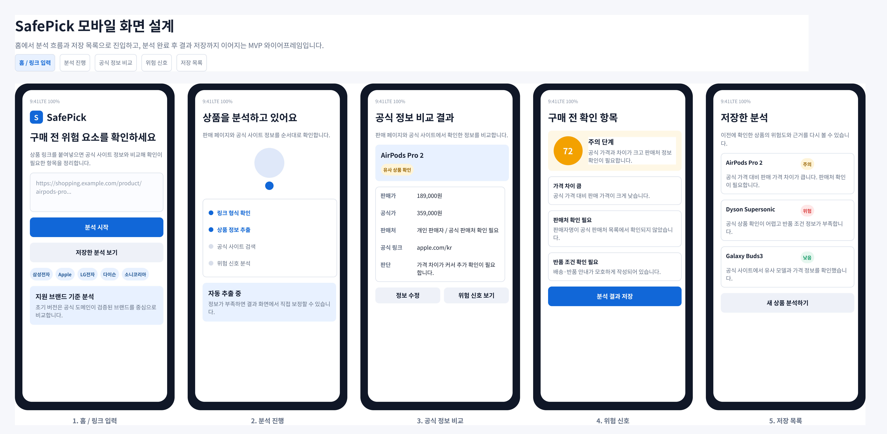

# SafePick

## 프로젝트 개요

**SafePick(세이프픽)**은 온라인 쇼핑 상품을 구매하기 전, 판매 페이지와 공식 사이트의 정보를 AI로 분석·비교하여 구매 위험 신호와 확인 근거를 제공하는 모바일 서비스입니다.

온라인 쇼핑에서는 지나치게 낮은 가격, 불명확한 판매자 정보, 과장된 설명, 모델명·구성품의 불일치처럼 사용자가 직접 비교하고 판단하기 어려운 정보가 많습니다. SafePick은 사용자가 상품 링크 하나를 입력하면 생성형 AI가 판매 페이지의 핵심 정보를 추출하고, 공식 도메인에서 확인한 상품 정보와 비교해 구매 전 확인해야 할 항목을 정리합니다.

사용자는 공식 상품 존재 여부, 가격 차이, 판매처 정보, 모델명과 구성품의 일치 여부를 한 화면에서 확인할 수 있습니다. 또한 AI가 과도한 할인 표현, 정보 누락, 배송·반품 조건의 모호함 등 위험 신호를 근거 문장과 함께 체크리스트로 보여 주며, 분석 결과는 저장해 여러 상품을 다시 비교할 수 있습니다.

이 서비스는 상품을 사기, 가품, 안전한 상품으로 단정하지 않습니다. 대신 정보가 부족하거나 서로 다를 때 근거와 확인 방법을 제공하는 **구매 전 판단 보조 도구**를 목표로 합니다. 경진대회 또는 향후 확장 단계에서는 사용자가 분석 결과를 바탕으로 구매 전 궁금한 점을 질문하면 AI가 수집된 근거와 공식 출처를 기반으로 답변하는 기능까지 제공합니다.

- GitHub: <https://github.com/lyh030526/SafePick>
- 지원 브랜드: 삼성전자, Apple, LG전자, 다이슨, 소니

## 문제 정의

- 소비자는 오픈마켓과 해외 쇼핑몰에서 상품 설명, 후기, 가격, 판매자 정보만으로 신뢰도를 판단하기 어렵습니다.
- 공식 사이트의 모델명, 가격, 구성품, 판매처 정보와 판매 페이지의 정보가 달라도 이를 직접 비교하는 데 시간이 듭니다.
- 정보가 없거나 모호한 상품일수록 구매 전 어떤 항목을 확인해야 하는지 알기 어렵습니다.

## 프로젝트 목표

1. 상품 링크 하나로 판매 페이지의 핵심 정보를 간단히 정리합니다.
2. 공식 도메인 기반 검색 결과를 제공해 사용자가 출처를 직접 확인할 수 있게 합니다.
3. 판매 페이지와 공식 사이트의 상품명, 모델명, 가격, 판매처, 구성품을 비교해 차이와 누락 정보를 안내합니다.
4. 과장 표현, 정보 불일치, 배송·반품 조건 등 구매 전 위험 신호를 체크리스트로 안내합니다.
5. 분석 결과와 공식 출처를 저장하고 다시 보며 여러 상품을 비교할 수 있게 합니다.

## 대상 사용자

- 쿠팡, 알리익스프레스, 테무 등 온라인 쇼핑몰을 자주 사용하는 소비자
- 고가 전자제품이나 해외 직구 상품을 구매하기 전 공식 정보를 확인하고 싶은 사용자
- 과장 광고, 구성품 혼동, 비공식 판매처가 걱정되는 사용자

## 기대 효과

- 상품 정보를 찾고 비교하는 시간을 줄여 구매 전 확인 과정을 단순화합니다.
- 공식 출처와 확인 근거를 함께 제공해 충동구매와 정보 부족으로 인한 구매 실수를 줄이는 데 도움을 줍니다.
- 생성형 AI가 복잡한 판매 정보를 사용자에게 이해하기 쉬운 형태로 정리합니다.

## 최종 핵심 기능

1. **공식 사이트 기반 상품 확인**: 판매 페이지 정보를 추출하고 공식 도메인만 검색해 동일·유사 상품, 공식 가격, 판매처 정보를 비교합니다. 추출이 어려운 항목은 사용자가 직접 보정할 수 있으며 근거가 없는 값은 `확인 불가`로 처리합니다.
2. **AI 상품 설명 위험 신호 분석**: 상품 설명, 구성품, 배송·반품 안내에서 정보 누락, 모델명·구성품 불일치, 과도한 할인과 구매 압박 표현을 찾아 구매 전 체크리스트와 근거 문장으로 제공합니다.
3. **분석 결과 저장 및 다시 보기**: 분석한 상품의 가격, 위험 신호, 공식 사이트 링크, 핵심 요약을 저장하고 목록에서 다시 확인하거나 여러 상품을 비교할 수 있습니다.

## 확장 기능

- **AI 구매 전 질문 답변**: 사용자가 "공식 사이트에서 찾았어?", "가격 차이가 큰 이유가 뭐야?"처럼 질문하면 AI가 해당 상품의 분석 결과와 공식 출처만 근거로 답변합니다.

## 시스템 구조

```text
[Expo 모바일 앱]
  상품 링크 입력 / 추출 결과 보정 / 공식 정보 결과 표시
            |
            v
[FastAPI 백엔드]
  URL 검증 -> 공개 페이지 텍스트 수집 -> LLM 상품 정보 추출
            |                         |
            |                         v
            |                   [OpenAI API]
            v
  지원 브랜드 확인 -> 검색어 생성 -> 공식 도메인 검색
                                         |
                                         v
                                  [Serper Search API]
```

## UI/UX 흐름



1. **링크 입력 화면**: 사용자가 온라인 쇼핑 상품 링크를 붙여 넣고 분석을 시작합니다.
2. **분석 진행 화면**: 링크 형식, 판매 페이지 수집, AI 분석의 진행 상태를 보여 줍니다.
3. **공식 정보 비교 화면**: 판매 페이지에서 추출한 상품 정보와 공식 도메인 검색 결과, 비교 근거를 보여 줍니다.
4. **위험 신호 화면**: 모델명·구성품 불일치, 정보 누락, 과장 광고, 배송·반품 조건 등 구매 전 확인 항목을 근거와 함께 제공합니다.
5. **저장 목록 화면**: 저장된 상품별 위험도 요약, 주요 확인 항목, 공식 출처를 다시 보고 여러 상품을 비교합니다.

## AI 활용 방식

- **상품 정보 구조화**: LLM이 판매 페이지의 공개 텍스트에서 브랜드명, 상품명, 모델명, 가격, 통화, 판매처, 구성품, 배송·반품 조건을 JSON 형식으로 추출합니다.
- **공식 상품 탐색과 비교**: 브랜드명·모델명을 바탕으로 공식 사이트 검색어를 만들고, 공식 페이지에서 동일·유사 모델, 공식 가격, 공식 판매처 정보를 추출해 판매 페이지 정보와 비교합니다.
- **위험 신호 분석**: 상품명·모델명·구성품의 불일치, 정보 누락, 과도한 할인·구매 압박 표현, 배송·반품 조건의 모호함을 찾아 근거 문장과 함께 구매 전 체크리스트로 정리합니다.
- **불확실성 처리**: 공식 정보나 판매 페이지 근거가 부족한 값은 추측하지 않고 `확인 불가`로 표시하며, 사용자가 직접 보정할 수 있게 합니다.
- **저장 결과 요약**: 분석 결과를 저장할 때 상품별 핵심 확인 항목과 위험 신호를 짧은 요약 문장으로 생성해 다시 보기와 상품 비교를 돕습니다.
- **AI 구매 전 질문 답변**: 사용자의 질문에 대해 해당 상품의 분석 결과와 공식 출처만 근거로 답변하고, 근거가 부족하면 추가 확인 방법을 안내합니다.

## 기술 스택

| 영역 | 기술 |
| --- | --- |
| 모바일 | React Native, Expo, TypeScript |
| 백엔드 | Python, FastAPI |
| AI | OpenAI API |
| 공식 검색 | Serper Google Search API |
| 개발 데이터 | SQLite, 향후 PostgreSQL |

## 실행 방법

### 1. API 서버

명령 프롬프트(cmd)에서 다음을 실행합니다.

```cmd
cd C:\Users\jsh68\Desktop\SafePick\apps\api
copy .env.example .env
notepad .env
python -m uvicorn main:app --port 8000
```

`.env`에 다음 값을 설정합니다. `SERPER_API_KEY`가 없으면 상품 추출은 가능하지만 공식 웹 검색은 안내 메시지로 대체됩니다.

```env
OPENAI_API_KEY=your_key
OPENAI_BASE_URL=https://api.openai.com/v1
OPENAI_MODEL=gpt-5.4-mini
SERPER_API_KEY=your_serper_key
```

### 2. 모바일 웹

새 cmd 창에서 다음을 실행합니다.

```cmd
cd C:\Users\jsh68\Desktop\SafePick\apps\mobile
copy .env.example .env
npm install
npm run web
```

브라우저에서 `http://localhost:8081`을 엽니다. API 서버는 `http://localhost:8000`에서 실행되어야 합니다.

## API

| Method | Endpoint | 설명 |
| --- | --- | --- |
| `GET` | `/health` | API 실행 상태를 확인합니다. |
| `GET` | `/brands` | 지원 브랜드와 공식 도메인을 반환합니다. |
| `POST` | `/analyses` | 상품 링크를 분석하고 공식 검색 결과를 반환합니다. |

## 프로젝트 구조

```text
SafePick/
├── apps/
│   ├── api/        # FastAPI 분석 및 공식 검색 API
│   └── mobile/     # Expo 모바일 앱
├── safepick-wireframe.html
├── README.md
└── .gitignore
```

## 개발 일정

| 기간 | 목표 |
| --- | --- |
| 1주차 (9/29~10/4) | 기획, 화면 흐름, 개발 환경, 공식 도메인 후보 선정 |
| 2주차 (10/5~10/11) | 링크 분석, 상품 정보 추출, 사용자 보정 입력 |
| 3주차 (10/12~10/18) | 공식 도메인 API, 지원 브랜드 판정, 공식 검색 연동 |
| 4주차 (10/19~10/25) | 공식 정보와 판매 정보 비교 결과 구현 |
| 5주차 (10/26~11/1) | AI 위험 신호 분석과 구매 전 체크리스트 구현 |
| 6주차 (11/2~11/8) | 분석 결과 저장·다시 보기, 기능 동결 |
| 7주차 (11/9~11/15) | 통합 테스트, 시연 자료와 발표 준비 |
| 11/16~11/17 | 최종 점검 및 발표 |

## 보안 및 한계

- API 키는 `.env`에만 보관하며 GitHub에 올리지 않습니다.
- 내부망·로컬 주소는 분석 대상에서 차단합니다.
- 쇼핑몰의 접근 제한(예: 403)으로 판매 페이지를 읽지 못하면 직접 입력을 요청합니다.
- 검색 결과는 공식 도메인과 다시 대조하지만, 최종 구매 판단은 사용자가 직접 해야 합니다.
